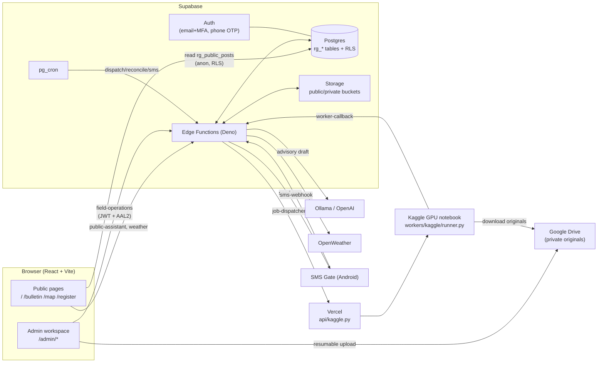

# RiceGuardAI — Website Documentation

> Gabay para sa thesis team: para maintindihan ang buong **website** (frontend, backend, database), at para malaman kung **saan hahanapin at paano babaguhin** ang code kapag may debugging, tatanggalin, o idadagdag na feature.
>
> Saklaw: **website lang** (`website_repo/`). Wala rito ang model training, dataset, CVAT, at manuscript.

Huling na-verify laban sa code: **2 Nov 2026**. Kung may nagbago sa code pagkatapos nito, ang code ang tama — i-update ang doc na ito.

---

## Talaan ng nilalaman

1. [Ano ang website na ito](#1-ano-ang-website-na-ito)
2. [Tech stack (framework, language, database)](#2-tech-stack)
3. [Malaking larawan ng architecture](#3-malaking-larawan-ng-architecture)
4. [Folder structure](#4-folder-structure)
5. [Frontend nang detalyado](#5-frontend-nang-detalyado)
6. [Backend: Supabase Edge Functions](#6-backend-supabase-edge-functions)
7. [Database: tables, RLS, migrations](#7-database)
8. [Kaggle worker at Vercel dispatcher](#8-kaggle-worker-at-vercel-dispatcher)
9. [Mga pangunahing daloy (flows)](#9-mga-pangunahing-daloy)
10. [Seguridad at access control](#10-seguridad-at-access-control)
11. [Environment variables at secrets](#11-environment-variables-at-secrets)
12. [Paano i-run, i-test, at i-deploy](#12-paano-i-run-i-test-at-i-deploy)
13. [Debugging guide](#13-debugging-guide)
14. [Paano magdagdag / magtanggal ng feature](#14-paano-magdagdag--magtanggal-ng-feature)
15. [Mga dapat bantayan (kilalang problema)](#15-mga-dapat-bantayan)
16. [Glossary](#16-glossary)

---

## 1. Ano ang website na ito

Ang RiceGuardAI ay website para sa pagsubaybay ng sakit ng palay (**Bacterial Leaf Blight / BLB** at **Brown Spot**) sa **Region II** (Batanes, Cagayan, Isabela, Nueva Vizcaya, Quirino).

May **dalawang uri ng gumagamit**:

| Gumagamit | Ano ang ginagawa | Login? |
|---|---|---|
| **Publiko / magsasaka** | Nagbabasa ng Field Bulletin, tumitingin sa Monitoring Map, nagrerehistro para sa SMS alerts, nagtatanong sa AI assistant | Wala (SMS OTP lang kapag magrerehistro) |
| **Admin / staff** | Nag-a-upload ng drone photos/video, nagre-review ng resulta ng AI, nagpa-publish ng advisory, nagpapadala ng SMS | Oo — email + password + **MFA (authenticator app)**, invite-only |

**Pangunahing prinsipyo ng sistema** (importante sa thesis defense):

- May **tao (staff) na dapat mag-review at mag-approve** bago lumabas ang kahit ano sa publiko o ma-SMS. Walang automatic na publish.
- Ang pampublikong mapa ay **approximate location lang**, hindi eksaktong GPS ng bukid.
- Ang resulta ng AI ay **"predicted"**, hindi diagnosis. Walang laman na resulta ≠ malusog ang palay (`No target disease detected`).
- Ang **Low/Moderate/High severity ay naka-disable** hanggang may aprubadong calibration. Ngayon, "Severity not yet calibrated" ang ipinapakita ng model; ang severity na lumalabas sa advisory ay galing sa **manual na review ng staff**.

### Mga pahina (routes)

| URL | Nilalaman | Sino |
|---|---|---|
| `/` | Home / landing page | Lahat |
| `/bulletin` | Listahan ng published advisories (may filter) | Lahat |
| `/advisories/:slug` | Isang advisory (detalye, media, panahon) | Lahat |
| `/map` | Public monitoring map | Lahat |
| `/register` | SMS registration (OTP + barangay + consent) | Lahat |
| `/preferences` | Baguhin / mag-opt-out sa SMS | Nakarehistro |
| `/login` | Admin login + MFA | Admin |
| `/admin/overview` | Dashboard ng operasyon | Admin (AAL2) |
| `/admin/surveys` | Listahan ng drone surveys | Admin |
| `/admin/surveys/new` | Upload ng photos/video | Admin |
| `/admin/review` | Guided review (4 hakbang) | Admin |
| `/admin/map` | Operations map (may pribadong detalye) | Admin |
| `/admin/advisories` | Advisory desk (edit, archive, sources) | Admin |
| `/admin/farmers` | Mga nakarehistrong contact at bukid | Admin |
| `/admin/sms` | SMS preview, send, delivery status | Admin |
| `/admin/model` | Model at system readiness | Admin |
| `/admin/settings` | Settings at audit | Admin |

Ang mga lumang URL (`/farmer/*`, `/demo/*`, `/system`, `/admin/scans`) ay **nire-redirect** na lang (tingnan ang `router.tsx`).

---

## 2. Tech stack

### Frontend (ang nakikita sa browser)

| Teknolohiya | Gamit | Saan makikita |
|---|---|---|
| **TypeScript** | Pangunahing wika (may type-checking) | lahat ng `.ts` / `.tsx` |
| **React 19** | UI library (components, hooks) | `frontend/src` |
| **Vite 6** | Build tool at dev server | `frontend/vite.config.ts` |
| **React Router 7** (`react-router-dom`) | Pag-navigate sa pagitan ng pages | `app/router.tsx` |
| **TanStack React Query** | Data caching (naka-set up sa providers) | `app/providers.tsx` |
| **Tailwind CSS 4** | Utility styling (kaunti lang ang gamit) | `styles/index.css` |
| **Plain CSS** | Karamihan ng styling ng aktwal na UI | `operations/operations.css` (~5,000 linya), `operations/landing/landing.css` |
| **Leaflet + react-leaflet** | Mapa (OpenStreetMap / MapTiler tiles) | `operations/Map.tsx` |
| **Three.js + @react-three/fiber + drei** | 3D rice field sa landing hero | `operations/landing/RiceField3D.tsx` |
| **Framer Motion**, **Lenis** | Animation at smooth scrolling | `components/motion/*` |
| **lucide-react**, **@phosphor-icons/react** | Mga icon | sa buong UI |
| **sonner** | Toast notifications | `app/providers.tsx` |
| **exifr** | Pagbasa ng EXIF/GPS ng drone photo | `operations/Upload.tsx` |
| **hash-wasm** | SHA-256 / MD5 checksum ng file sa browser | `operations/Upload.tsx` |
| **zod**, **react-hook-form**, **date-fns** | Validation / forms / petsa (nakalista sa dependencies; kaunti ang gamit sa aktibong code) | `package.json` |
| **Vitest + Testing Library + jsdom + PGlite** | Automated tests | `operations/*.test.ts(x)` |
| **ESLint** | Code linting | `eslint.config.js` |

### Backend

| Teknolohiya | Gamit |
|---|---|
| **Supabase** (hosted) | Auth, Postgres database, Storage, Cron (`pg_cron`), Edge Functions |
| **PostgreSQL + PostGIS-style na geo checks** | Database; may Row Level Security (RLS) |
| **Supabase Edge Functions** (Deno runtime, **TypeScript**) | Lahat ng server-side logic (`supabase/functions/*`) |
| **Python 3** | `api/kaggle.py` (Vercel function) at `workers/kaggle/runner.py` (Kaggle worker) |

### Mga external service

| Serbisyo | Para saan |
|---|---|
| **Vercel** | Hosting ng frontend + maliit na Python function na nagpapadala ng job sa Kaggle |
| **Google Drive** (resumable upload) | Pribadong lalagyan ng original na drone photo/video at malalaking output |
| **Kaggle** (private notebook, GPU) | Pagpapatakbo ng AI inference (asynchronous) |
| **Ollama Cloud** (opsyonal OpenAI) | Pagsulat ng draft advisory at sagot ng public assistant (structured JSON) |
| **OpenWeather** | Panahon sa paligid ng advisory (cache 10 min) |
| **SMS Gate** (Android phone) | Pagpapadala ng SMS at OTP, delivery receipts |
| **OpenStreetMap / MapTiler** | Map tiles (MapTiler kung may `VITE_MAPTILER_KEY`) |

> **Walang Redux/Zustand.** Ang state ay React Context (`AuthContext`, `LangContext`, `OperationsProvider`) + lokal na `useState`.

---

## 3. Malaking larawan ng architecture



**Mahalagang tuntunin:** ang browser ay **hindi kailanman** nakakakuha ng Google/Kaggle/SMS/Ollama/service-role credentials. Lahat ng sensitibong tawag ay dumadaan sa Edge Function. Ang browser ay may **public (anon) key lang**.

---

## 4. Folder structure

```
website_repo/
├── README.md                  # Pangkalahatang setup (English)
├── BACKEND.md                 # Backend reference (tables, functions, secrets)
├── BACKEND_ARCHITECTURE.md    # Mas malalim na backend notes
├── vercel.json                # Build config + SPA rewrite + api/kaggle.py
├── requirements.txt           # Python deps ng Vercel function (kaggle)
├── pytest.ini
│
├── frontend/                  # ← ANG WEBSITE (React + Vite)
│   ├── index.html             # Boot loader + meta tags
│   ├── package.json           # Dependencies at npm scripts
│   ├── vite.config.ts         # Alias "@" → src, vendor chunks
│   ├── .env.example           # Mga VITE_ variables (public lang)
│   ├── public/                # Static: images, video, geojson, 3D model
│   └── src/                   # (tingnan ang §5)
│
├── supabase/
│   ├── config.toml            # Auth + per-function verify_jwt settings
│   ├── migrations/            # Lahat ng pagbabago sa database (SQL, nakaayos ayon sa petsa)
│   ├── seed.sql
│   └── functions/             # Edge Functions (Deno/TS)
│       ├── _shared/           # Code na ginagamit ng maraming function
│       └── <function>/index.ts
│
├── api/kaggle.py              # Vercel Python function: nagpapasa ng job sa Kaggle
├── workers/kaggle/runner.py   # Code na tumatakbo SA LOOB ng Kaggle GPU
├── docs/                      # Mga audit/release notes (+ ang doc na ito)
├── qa/                        # Mga script para sa QA/verification at data import
└── tools/ , shared/ , azure-api/ , output/   # Pantulong; hindi bahagi ng runtime ng website
```

---

## 5. Frontend nang detalyado

Lahat ay nasa `frontend/src/`. May alias na **`@` = `frontend/src`** (hal. `import { supabase } from "@/lib/supabase"`).

### 5.1 Paano nag-boot ang app

```
index.html  →  src/main.tsx  →  <Providers>  →  <AppRouter>
```

1. **`index.html`** — may inline na loading screen (`#rg-boot-loader`) para walang blangkong screen habang naglo-load.
2. **`main.tsx`** — nagre-render ng React; sa `/` lang nagpa-preload ng mga larawan (mascot, hero) para smooth ang unang tingin, at nagtatago ng loader (`rg-app-ready`).
3. **`app/providers.tsx`** — bumabalot sa buong app ng: `QueryClientProvider` → `LangProvider` → `AuthProvider` + `Toaster`.
4. **`app/router.tsx`** — lahat ng route (tingnan ang §1). Ang `/login` at `/admin/*` ay **lazy-loaded** (hiwalay na bundle para mabilis ang public pages).

### 5.2 Mga folder sa `src/`

| Folder / file | Papel |
|---|---|
| **`operations/`** | ⭐ **Ang aktibong puso ng website** — public pages, admin workspace, upload, review, mapa, SMS. Karamihan ng babaguhin mo ay dito. |
| `app/` | `providers.tsx`, `router.tsx` (aktibo). `router.legacy.tsx` ay luma, hindi gamit. |
| `context/` | `AuthContext` (session, profile, MFA level), `LangContext` (tl/en) |
| `lib/supabase.ts` | Gumagawa ng 2 Supabase client (tingnan sa ibaba) |
| `components/guards/ProtectedRoute.tsx` | Harang sa `/admin/*` |
| `components/motion/` | `useSmoothScroll` (Lenis), `useParallax` |
| `styles/index.css` | Tailwind import + kulay/font tokens (rice/forest/soil) |
| `pages/public/Login.tsx` | ✅ **Aktibo** — admin login/MFA |
| `pages/`, `services/`, `components/layout/`, `components/map/`, `components/LanguagePicker.tsx`, `types/` | ⚠️ **Legacy** — tingnan ang §5.8 |

### 5.3 `lib/supabase.ts` — dalawang Supabase client

| Client | Gamit | Bakit hiwalay |
|---|---|---|
| `supabase` | Admin login, public reads, tawag sa Edge Functions | Default na auth storage |
| `subscriberSupabase` | SMS verification ng magsasaka (`/register`, `/preferences`) | May **ibang storage key** (`riceguard-subscriber-auth-v1`) para hindi mapalitan ang session ng admin kapag sabay na bukas sa iisang browser |

Kung walang `VITE_SUPABASE_URL`/`VITE_SUPABASE_ANON_KEY`, hindi mag-crash ang public site (placeholder lang), pero hindi gagana ang login at data.

### 5.4 Auth at proteksyon ng admin routes

- **`context/AuthContext.tsx`** — kumukuha ng session, nagbabasa ng `profiles` row (role, `is_active`, `full_name`), at nagtatanong ng **AAL** (`aal1` = password lang, `aal2` = may MFA code na).
- **`components/guards/ProtectedRoute.tsx`** — para sa `/admin/*`, kailangang:
  1. may session → kung wala, `/login`
  2. may profile na tama ang `role` ("admin")
  3. `is_active = true`
  4. **`aal === "aal2"`** → kung hindi pa, balik sa `/login` para sa MFA
- **`pages/public/Login.tsx`** — mga hakbang: `password` → (`setup` kung invitation/recovery link) → `mfa` o `enroll` (QR code para sa authenticator) → `/admin/overview`. Tinatanggihan ang kahit sino na hindi **active na invited admin**.

> Ang proteksyon sa frontend ay *kaginhawaan lang*. Ang **tunay na proteksyon** ay nasa server: tinitiyak ng `field-operations` na `aal2` ang token (§10).

### 5.5 `operations/` — mga file ayon sa tungkulin

#### A. Public site

| File | Ano ang laman |
|---|---|
| `Public.tsx` | `PublicFrame` (header/footer), `HomePage`, `BulletinPage`, `AdvisoryPage`, `PublicMapPage`, `BulletinCard`, media gallery, weather card, bookmarks (localStorage) |
| `publicPosts.ts` | `usePublicPosts()` hook — binabasa ang `rg_public_posts` (paginated, may filter sa disease/location/date); `toBulletin()` ginagawang `Bulletin` ang database row |
| `landing/HomeLanding.tsx` + `RiceField3D.tsx` + `landing.css` | Bagong landing page (hero na may 3D rice field, "problem", "how it works", film, SMS preview, latest advisories, map). ⚠️ Tingnan ang §15 — kasalukuyang hindi ito naka-wire |
| `Assistant.tsx` | Chat widget (`AssistantWidget`) na tumatawag sa `public-assistant`; may "walkthrough/tour" (`BulletinWalkthrough`) |
| `Registration.tsx` | `/register` at `/preferences`: phone → OTP → pumili ng Province→City→Barangay (galing sa `rg_locations`) → consent → `register-contact` |
| `registrationStatus.ts` | Hooks (`useSmsRegistration`, `useSubscriberSession`) at maliit na cache sa localStorage ng registration |
| `WeatherLocation.tsx`, `weatherPresentation.ts` | Pagpili ng munisipyo para sa panahon at pag-format ng datos |
| `advisoryPresentation.ts`, `advisoryContent.ts`, `bulletinMedia.ts` | Pag-format ng teksto/aksyon ng advisory at layout ng media mosaic |
| `Map.tsx` | `FieldMap` — Leaflet map (markers, clusters, Region II boundary, satellite toggle). `LazyMap.tsx` ay lazy wrapper nito |
| `mapPoints.ts` | `groupMapPoints`, `clusterMapPoints` — pag-grupo ng magkatabing pin (hindi ginagalaw ang tunay na coordinates) |

#### B. Admin workspace

| File | Ano ang laman |
|---|---|
| `Admin.tsx` | `OperationsRoot` (nagbibigay ng `OperationsProvider`), `OperationsShell` (sidebar/header), at ang mga pahina: `OverviewPage`, `SurveysPage`, `MapPage`, `AdvisoryDesk`, `FarmersPage`, `SmsPage`, `SystemPage`, `SettingsPage`. Ang `OperationsPage` ang **switch** na pumipili ng pahina batay sa URL |
| `Upload.tsx` | `UploadWorkspace` (pag-upload ng photo/MP4 → Google Drive) at `ReviewWorkspace` (pagsusuri ng resulta ng AI) |
| `ReviewJourney.tsx` | Ang 4-hakbang na wizard: **Review images → Review severity → Confirm location → Preview & publish**; may babala kapag may hindi pa nase-save |
| `SeverityAssessment.tsx` | Form ng manual na severity review ng staff |
| `SmsDelivery.tsx`, `SmsSystemTest.tsx` | SMS preview/enqueue/status at test ng gateway |
| `store.tsx` | ⭐ `OperationsProvider` + `useOperations()` — pinagmumulan ng data ng buong admin (tingnan sa ibaba) |
| `fieldOperations.ts` | `fieldOperation(action, payload)` — **iisang pintuan** papunta sa `field-operations` Edge Function; may `FieldOperationError` at mga Tagalog na error message |
| `processingStatus.ts` | `processingSignature()` — pambantay kung nagbago ang status para mag-refresh lang kung kailangan |
| `domain.ts` | Mga **type** (`Survey`, `Bulletin`, `Contact`, `Campaign`, `Asset`, `ProcessingJob`, `Prediction`…) at pure functions: `normalizePhone`, `smsSegments`, `distanceMeters`, `validatePrediction`, `isQuietHour` |
| `data.ts` | Sample/demo na datos (fixtures) |
| `photoLocation.ts`, `uploadRecovery.ts` | Pagkuwenta ng lokasyon mula sa EXIF GPS ng mga larawan; pag-resume ng naputol na upload |
| `severityPresentation.ts` | Label ng severity (hal. "Severe", "Not calibrated") |

#### C. Estilo at test

| File | Ano ang laman |
|---|---|
| `operations.css` | Halos lahat ng class na `rg-*` (layout, cards, forms, admin sidebar, bulletin…) |
| `accessibility.css` | Focus ring, skip link, reduced-motion, atbp. |
| `*.test.ts(x)` | 29 test files — hal. `domain.test.ts`, `inference.test.ts`, `smsDelivery*.test.ts`, `reviewWorkflow.*.test.*` |

### 5.6 Paano gumagana ang `store.tsx` (data ng admin)

```
OperationsProvider
 ├─ refresh()          → operation("snapshot")       # kumukuha ng buong datos (surveys, bulletins, contacts, campaigns, assets, jobs, providers, models)
 ├─ polling (5s)       → operation("processing-status") # magaan; kapag nagbago ang "signature" saka lang mag-refresh ng buo
 │                        (humihinto kapag nakatago ang tab o offline; may balik-buhay sa focus/online)
 └─ actions            → addSurvey, review, saveDraft, generateAdvisory, publish, addContact
                         (bawat isa: tumatawag sa field-operations, tapos refresh())
```

- Ang `useOperations()` ang gagamitin ng anumang admin page para makuha ang `data`, `loading`, `error`, `refresh`, `operation`.
- May **`demo` mode** (localStorage + `data.ts`); sa production route (`/admin`) ay laging `demo={false}`.
- Ang `publish` ay: `recipient-preview` muna (kumuha ng hash) → `publish` na may `send_sms: false`. **Ang SMS ay hiwalay na hakbang** (`SmsDelivery`), hindi kasabay ng publish.

### 5.7 Mga halimbawa ng pag-flow ng data sa isang page

**Public Bulletin (`/bulletin`)** — walang Edge Function:
`BulletinPage` → `usePublicPosts()` → `supabase.from("rg_public_posts").select("*")` → RLS: pwede sa `anon` → `toBulletin()` → `BulletinCard`.

**Admin page (hal. Farmers)** — laging dumadaan sa Edge Function:
`FarmersPage` → `useOperations().data.contacts` ← galing sa `snapshot` ← `field-operations` (nagche-check ng admin+AAL2, gumagamit ng service-role key).

### 5.8 Legacy / hindi aktibong code

Ang mga ito ay **hindi na naka-route** sa `router.tsx` at mula sa unang bersyon ng proyekto (gumagamit ng ibang tables tulad ng `drone_scans`, `disease_detections`, `advisories`):

- `src/pages/admin/*`, `src/pages/farmer/*`, `src/pages/public/Landing.tsx`, `Register.tsx`, `SystemEvidence.tsx`
- `src/components/layout/*` (`AdminLayout`, `FarmerLayout`, `PublicLayout`), `components/map/LeafletMap.tsx`, `components/LanguagePicker.tsx`
- `src/services/*`, `src/types/database.ts`, `src/types/domain.ts`, `utils/phone.ts`, `utils/authErrors.ts`
- `src/app/router.legacy.tsx` (hindi pa kasama sa lint, ayon sa `eslint.config.js`)

Ligtas silang **huwag galawin** para sa karaniwang gawain. Kung maglilinis ang team, siguraduhing walang aktibong file na nag-i-import sa kanila (`grep -rn "@/pages\|@/services\|components/layout" src`). Ang tanging aktibong import mula sa mga ito ay `pages/public/Login.tsx` at `types/database.ts` (ginagamit ng `AuthContext`/`ProtectedRoute` para sa `Profile`/`UserRole`).

---

## 6. Backend: Supabase Edge Functions

Lokasyon: `supabase/functions/<pangalan>/index.ts` (Deno + TypeScript). Ang `verify_jwt` ay nasa `supabase/config.toml` at sa `--no-verify-jwt` flag sa deploy.

### 6.1 Mga function

| Function | Tinatawag ng | Auth | Tungkulin |
|---|---|---|---|
| **`field-operations`** | Browser (admin at subscriber) | JWT; admin actions = **AAL2 kinakailangan** | Iisang API ng buong operasyon. Nakabase sa `action` (tingnan §6.2) |
| **`generate-advisory`** | Admin browser | JWT | Gumagawa ng draft advisory mula sa validated na findings + aprubadong guidance lang (Ollama/OpenAI), may weather context |
| **`public-assistant`** | Public browser | Walang JWT, may rate-limit | Chatbot na sumasagot sa Tagalog tungkol sa bulletin/mapa/SMS/BLB/Brown Spot |
| **`weather`** | Browser | JWT | OpenWeather wrapper, 10-min cache sa `weather_cache`, konserbatibong Tagalog na konteksto (hindi disease-risk) |
| **`job-dispatcher`** | `pg_cron` (bawat 5 min) | Cron secret | Kumukuha ng 1 queued job at ipinapasa sa Vercel dispatcher |
| **`job-reconciler`** | `pg_cron` (bawat 10 min) | Cron secret | Sinusuri ang running/uncertain na Kaggle runs at may hangganang failure handling |
| **`worker-callback`** | Kaggle worker | Run-scoped token | Tumatanggap ng progress at huling resulta; replay-safe; vina-validate ang manifest |
| **`send-sms`** | `pg_cron` (bawat 5 min) | Cron secret | Outbox: tinitingnan muli ang consent, quiet hours, idempotent send, bounded retry |
| **`sms-webhook`** | SMS Gate | HMAC signature | Delivery receipts at inbound **STOP** |
| **`auth-sms-hook`** | Supabase Auth | Webhook signature | Nagpapadala ng **OTP** sa pamamagitan ng SMS Gate (hiwalay sa alert consent) |
| `weekly-digest` | (may sample na pg_cron sa comment ng file; walang migration na nag-i-schedule nito) | Service role | Lingguhang buod na SMS |
| `ai-advisor`, `infer-scan` | — | — | **Retired**; nagbabalik ng `410` |
| `aws-dispatcher`, `aws-reconciler` | `pg_cron` (sa AWS migrations) | Cron secret | Naunang AWS pathway; hindi na ginagamit ayon sa README ("walang automatic paid AWS fallback"). Kumpirmahin muna bago tanggalin |

### 6.2 `field-operations` — listahan ng `action`

Ang request ay: `POST /functions/v1/field-operations` na may `{ "action": "...", "payload": {...} }`. Ang frontend ay laging tumatawag sa pamamagitan ng `fieldOperation()`.

| Grupo | Mga action |
|---|---|
| **Subscriber (SMS)** | `registration-status`, `register-contact`, `opt-out` |
| **Admin: data/status** | `snapshot`, `processing-status`, `system-readiness`, `advisory-guidance`, `approve-advisory-source` |
| **Admin: survey at upload** | `create-survey`, `upload-intent`, `resume-upload-intent`, `upload-complete`, `upload-failed`, `recover-upload`, `retry-processing` |
| **Admin: review** | `review-readiness`, `save-severity-review`, `save-location`, `save-field-severity`, `review-survey` |
| **Admin: advisory** | `save-draft`, `archive-advisory`, `create-correction`, `recipient-preview`, `publish` |
| **Admin: SMS/contacts** | `sms-preview`, `sms-enqueue`, `sms-status`, `create-contact` |

Estruktura ng handler (sa `Deno.serve`): CORS/origin check → kunin ang bearer token → `db.auth.getUser(token)` → basahin ang JSON (limit 120 KB) → serye ng `if (action === "...")`. Ang mga subscriber action ay nasa itaas; bago ang unang admin action (`advisory-guidance`) ay may check na admin + `is_active` + `aal2` (≈ line 502–505) — kaya **ang lahat ng action pagkatapos nito ay admin-only**.

### 6.3 `_shared/` — code na ginagamit ng maraming function

Pure at testable ang karamihan (may kaparehong test sa `frontend/src/operations/*.test.ts`).

| File | Laman |
|---|---|
| `pinnedResult.ts` | Hash/kontrata ng "pinned" na two-specialist model workflow; validation ng result manifest |
| `reviewWorkflow.ts` | Mga hakbang ng review, readiness, validation ng severity review at coordinates |
| `fieldSeverity.ts`, `severityRecommendation.ts` | Validation ng manual na severity at AI visual suggestion |
| `advisoryEvidence.ts`, `advisoryCandidates.ts`, `advisoryPresentation.ts` | Aprubadong guidance, draft validation, SMS text ng advisory |
| `openai-advisory.ts` | Opsyonal na OpenAI adapter |
| `mediaSelection.ts` | Validation ng media na ipa-publish |
| `smsDelivery.ts`, `smsSystemTest*.ts` | SMS segments, quiet hours (Manila), gateway selection, delivery state |
| `systemReadiness.ts` | `inferenceConfiguration()` — "configured/disabled" lang, **hindi patunay na gumagana ang GPU** |
| `weatherContext.ts`, `regionIIWeatherPoints.json` | Weather insights; 93 representative na punto ng munisipyo |
| `cors.ts`, `ratelimit.ts`, `awsSigV4.ts` | CORS helper, rate limit, AWS signing (legacy) |

> Ang `Admin.tsx` at `ReviewJourney.tsx` ay direktang nag-i-import mula sa `supabase/functions/_shared/*` (hal. `systemReadiness`, `reviewWorkflow`) para pareho ang rules sa frontend at backend. **Kapag ginalaw mo ang `_shared`, apektado pareho** at dapat i-redeploy ang mga function.

---

## 7. Database

Platform: **Supabase Postgres**. Lahat ng pagbabago ay nasa `supabase/migrations/` (SQL, patakbuhin ayon sa pangalan/petsa). **Huwag mag-edit ng lumang migration** — gumawa ng bagong file.

### 7.1 Mga pangunahing table (aktibong sistema, prefix `rg_`)

| Table | Laman |
|---|---|
| `rg_surveys` | Isang drone survey/batch: pangalan, lokasyon (pribado), status, active/approved result revision |
| `rg_assets` | Bawat original na photo/video: checksum, Drive file ID, estado ng upload |
| `rg_upload_sessions` | Pag-track ng resumable uploads |
| `rg_processing_jobs` | Pila ng Kaggle jobs (may lease, run ID, idempotent) |
| `rg_job_callbacks` | Mga callback ng worker (replay-safe) |
| `rg_model_registry` | Rehistro ng model checkpoints (**hindi** ginagamit bilang gate ng pinned pathway) |
| `rg_result_revisions` | Immutable na validated result manifests |
| `rg_finding_reviews` | Desisyon ng staff sa bawat finding (accept/reject) |
| `rg_severity_calibrations` | Calibration ng severity; **inactive** hanggang aprubado |
| `rg_advisory_sources` | Aprubadong sanggunian ng guidance (galing sa agri specialists) |
| `rg_bulletins` | Draft → published na advisory; revisions; napiling media/lokasyon |
| `rg_public_posts` | **Sanitized public projection** — ito lang ang nababasa ng publiko (approximate lat/lng lang) |
| `rg_contacts`, `rg_consent_events`, `rg_farms` | Subscriber: phone (verified), consent history, lokasyon ng bukid |
| `rg_campaigns`, `rg_recipients`, `rg_outbox` | SMS campaign, bawat tatanggap, at pila ng ipapadala |
| `rg_events`, `audit_events` | Audit trail (ang `BACKEND.md` ay tumutukoy sa `rg_audit`, pero wala itong `create table` sa mga migration — `rg_events`/`audit_events` ang nakikita sa SQL) |
| `rg_locations`, `rg_location_releases`, `rg_coverage` | Listahan ng Region II: probinsya → munisipyo → barangay (publikong nababasa) |
| `profiles` | Bawat auth user: `role` (`admin`/`farmer`), `is_active`, `full_name` (awtomatikong ginagawa ng trigger `handle_new_user`) |
| `weather_cache`, `rate_limits`, `login_audit` | Pantulong |

**Legacy tables** mula sa `0001_init.sql`: `drone_scans`, `disease_detections`, `advisories`, `notification_preferences` — para sa lumang `pages/*`; hindi gamit ng aktibong UI.

### 7.2 Row Level Security (RLS)

- Naka-**enable ang RLS** sa mga `rg_*` table. Default na patakaran: **`staff_read`** — admin lang (`is_admin()`) ang pwedeng mag-`select`.
- Mga eksepsiyon na pwede sa publiko (`anon`): `rg_public_posts`, `rg_locations`, `rg_location_releases`.
- Ang subscriber ay nakakabasa lang ng **sarili niyang** `rg_contacts`/`rg_farms` (`account_id = auth.uid()`).
- Lahat ng **pagsusulat** ay dumadaan sa Edge Functions gamit ang service-role key, hindi direkta mula sa browser.
- May mga "private" na Postgres function (`private.rg_*`) at publikong RPC (`rg_publish_bulletin_v2`, `rg_sms_*`, `rg_review_*`…) na tinatawag ng Edge Functions — nandoon ang mahahalagang transaksiyon (hal. ang **iisang transaksiyon ng publish**).

### 7.3 Storage buckets

| Bucket | Gamit |
|---|---|
| `rg-review-previews` | Pribadong preview ng resulta para sa review |
| `rg-public-previews` | Publikong kopya ng **aprubadong** media lang (max ~50 MB bawat file) |

Ang mga original na drone file ay nasa **Google Drive**, hindi sa Supabase Storage.

### 7.4 Cron jobs (`pg_cron`)

| Pangalan | Iskedyul | Tinatawag |
|---|---|---|
| `riceguard-dispatch` | bawat 5 min | `job-dispatcher` |
| `riceguard-reconcile` | bawat 10 min | `job-reconciler` |
| `riceguard-sms` | bawat 5 min | `send-sms` |
| `riceguard-aws-dispatch` / `-reconcile` | 2 / 5 min | AWS (legacy) |

Kailangan ng Vault secrets `riceguard_project_url` at `riceguard_cron_secret`; kung wala, **fail-closed** (walang external call).

### 7.5 Mga migration — buod ng kasaysayan

| Panahon | Ginawa |
|---|---|
| `0001`–`0006` | Unang schema (profiles, scans, detections, advisories), RLS, audit, seed |
| `20260906…field_operations` | Bagong `rg_*` na modelo: locations, contacts, surveys, assets, bulletins, campaigns, outbox |
| `20260921…website_finalization` | Jobs, callbacks, result revisions, public posts, storage, cron |
| `20260922–23` | Bulletin revisions, SMS gate cron, Region II locations (~2,400 linya ng datos) |
| `20260927` | AWS inference pathway (ngayon legacy) |
| `20260928–30` | Advisory sources, pinned video/photo workflow, Kaggle worker pin, context-aware advisories |
| `20261001` | Weather validation, field severity, archive ng test records, reviewed severity |
| `20261004–05` | Guided review workflow, predicted overlay, SMS reviewed delivery |

---

## 8. Kaggle worker at Vercel dispatcher

### `api/kaggle.py` (Vercel, Python)

- Maikling function (max 60s, tingnan `vercel.json`) na **HMAC-authenticated** gamit ang `KAGGLE_DISPATCH_SECRET`.
- Gamit ang opisyal na Kaggle client: **nagpu-push ng private kernel** at nagche-check ng status.
- **Hindi** nagpapatakbo ng model at hindi nagde-decode ng video.
- May `BUNDLE_SHA256` at listahan ng `PINNED_SOURCES` — ang worker code ay "pinned" (hash-verified).

### `workers/kaggle/runner.py` (tumatakbo sa Kaggle GPU)

1. Kumukuha ng run-scoped token; nagda-download ng **authorized na originals lang** mula sa Drive at ng pinned na model checkpoints (may hash check).
2. Pinapatakbo ang **dalawang independent na specialist** (BLB at Brown Spot) gamit ang `segmentation-models-pytorch`, may tiling para sa malalaking larawan.
3. Binubuo muli ang mga mask sa **native coordinates**; para sa video, nakatali sa timestamp.
4. Ina-upload ang private results sa Drive at nagpapadala ng validated manifest sa `worker-callback`.

Kapag naubos ang GPU quota: status na **"Waiting for GPU"** at maingat na retry; walang awtomatikong bayad na fallback.

---

## 9. Mga pangunahing daloy

### 9.1 Mula drone hanggang publikong advisory (pangunahing proseso)

```
1. Admin: /admin/surveys/new
   └─ pumili ng photos/MP4 → Upload.tsx: EXIF GPS (exifr) + SHA-256/MD5 (hash-wasm)
2. field-operations: create-survey → upload-intent → (browser nag-upload sa Google Drive, resumable)
   └─ upload-complete  (may upload-failed / recover-upload / resume-upload-intent para sa naputol)
3. Job pumasok sa rg_processing_jobs  →  cron job-dispatcher  →  Vercel api/kaggle.py  →  Kaggle runner
4. Kaggle: BLB + Brown Spot inference → worker-callback → rg_result_revisions   (status: Running → Validating results → Needs review)
5. Admin: /admin/review  (ReviewJourney, 4 hakbang)
   ├─ Review images      (tanggapin/tanggihan ang findings, piliin ang media)
   ├─ Review severity    (manual na severity ng staff: save-severity-review)
   ├─ Confirm location   (approximate pin o "no pin": save-location)
   └─ Preview & publish  (generate-advisory → save-draft → publish)
6. publish (isang transaksiyon): rg_bulletins → rg_public_posts  (+ pampublikong kopya ng media)
7. Publiko: /bulletin, /advisories/:slug, /map  ← binabasa ang rg_public_posts
8. (HIWALAY) Admin: /admin/sms → sms-preview → sms-enqueue (kailangang i-confirm, may hash)
   └─ cron send-sms → SMS Gate → sms-webhook (accepted / delivered / failed)
```

**Mga estado ng job** (sa `domain.ts`, `JobState`): `Awaiting upload → Validating → Queued → Submitting → Waiting for GPU / Waiting for allowance → Running → Validating results → Needs review → Reviewed`; may `Failed` at `Cancelled`.

### 9.2 Pagrerehistro ng magsasaka sa SMS

```
/register → ilagay ang PH mobile number (utils: normalizePhone)
  → supabase (subscriberSupabase).auth.signInWithOtp → auth-sms-hook → SMS Gate → OTP
  → i-verify ang OTP
  → pumili ng Province → City/Municipality → Barangay (rg_locations, active release lang)
  → consent checkbox → field-operations: register-contact
     (error codes: AUTH_REQUIRED, PHONE_VERIFICATION_REQUIRED, INVALID_LOCATION, CONTACT_CONFLICT, PILOT_LIMIT_REACHED, VALIDATION_ERROR)
  → /preferences: opt-out (opt-out action) o STOP via SMS (sms-webhook)
```

May **pilot limit na 100 contacts** sa demo mode (`store.tsx`); sa live ay may error code na `PILOT_LIMIT_REACHED` mula sa server. Tandaan: ang `snapshot` ay naglilista rin ng hanggang 100 contacts lang (`.limit(100)`).

### 9.3 Admin login

```
/login → email+password → tiyaking active admin ang profile
   → kung may verified TOTP: mfa.challenge → ilagay ang 6-digit code
   → kung wala pa: mfa.enroll → QR code → i-scan sa authenticator → verify
   → aal2 → /admin/overview
```
Invite-only ang mga admin account (walang public sign-up).

---

## 10. Seguridad at access control

| Patakaran | Saan ipinapatupad |
|---|---|
| Walang secret sa browser | Tanging `VITE_SUPABASE_URL`, `VITE_SUPABASE_ANON_KEY` (at opsyonal na `VITE_MAPTILER_KEY`) ang nasa bundle |
| Admin = active + invited + MFA | `ProtectedRoute` (UI) **at** tinitiyak ng `field-operations` na `profiles.role = 'admin'`, `is_active`, at `aal2` ang token (tunay na harang) |
| Publiko, nababasa lang ang sanitized data | RLS: `rg_public_posts` lang; approximate lat/lng |
| Tamang origin lang | `APP_ORIGIN` check sa `field-operations` |
| Limitadong request size | 120 KB sa `field-operations` |
| Cron/webhook endpoints | Secret/HMAC (`CRON_SECRET`, `SMS_GATE_WEBHOOK_SECRET`, run-scoped worker token), kaya `verify_jwt = false` |
| Hindi na-publish nang walang review | `publish` ay nangangailangan ng exact `advisory_revision` at `recipient_preview_hash`; stale review ay tinatanggihan |
| Consent at quiet hours sa SMS | `send-sms` + `smsDelivery.ts` (quiet hours sa oras ng Maynila, 6 AM ang susunod na bukas) |
| Audit | `rg_events` / `audit_events` |

---

## 11. Environment variables at secrets

> ⚠️ **Huwag mag-commit ng totoong secret.** Ang `frontend/.env.local` ay lokal lang (nasa `.gitignore`).

### Frontend (`frontend/.env.local`; kopyahin mula sa `.env.example`)

| Variable | Gamit |
|---|---|
| `VITE_SUPABASE_URL` | URL ng Supabase project |
| `VITE_SUPABASE_ANON_KEY` | Public (publishable) key |
| `VITE_MAPTILER_KEY` | Opsyonal; kapag walang laman, OpenStreetMap ang gamit |

Anumang may prefix na `VITE_` ay **makikita ng lahat**. Huwag maglagay ng sensitibo.

### Supabase Edge Function secrets (Dashboard → Edge Functions → Secrets, o `supabase secrets set`)

| Grupo | Mga pangalan (tingnan ang `README.md`/`BACKEND.md` para sa kumpletong listahan) |
|---|---|
| App | `APP_ORIGIN`, `CRON_SECRET`, `RG_PUBLIC_BASE_URL`, `WORKER_CALLBACK_SECRET` |
| Google Drive | `GOOGLE_DRIVE_CLIENT_ID/SECRET/REFRESH_TOKEN`, `GOOGLE_DRIVE_APP_FOLDER_ID` (sa BACKEND.md: `GOOGLE_CLIENT_*`) |
| Kaggle | `KAGGLE_DISPATCH_URL`, `KAGGLE_DISPATCH_SECRET` |
| AI | `OLLAMA_API_KEY`, `OLLAMA_BASE_URL`, `OLLAMA_MODEL`; opsyonal `OPENAI_API_KEY`, `OPENAI_MODEL` |
| Panahon | `OPENWEATHER_API_KEY` |
| SMS | `SMS_GATE_URL`, `SMS_GATE_TOKEN` o `SMS_GATE_USER`/`SMS_GATE_PASS`, `SMS_GATE_WEBHOOK_SECRET` |

May bahagyang pagkakaiba sa pangalan ng ilang secret sa pagitan ng `README.md` at `BACKEND.md` — **ang code ng function ang batayan** (`grep -rn "Deno.env.get" supabase/functions`).

### Vercel (server variables)
`KAGGLE_USERNAME`, `KAGGLE_KEY`, `KAGGLE_KERNEL_SLUG`, `KAGGLE_DISPATCH_SECRET` (parehong halaga sa Supabase).

### Supabase Vault
`riceguard_project_url`, `riceguard_cron_secret` — kailangan ng mga cron job.

---

## 12. Paano i-run, i-test, at i-deploy

### I-run sa sariling computer

```powershell
cd website_repo\frontend
npm install
copy .env.example .env.local     # ilagay ang tamang VITE_ values
npm run dev                      # http://localhost:5173
```

### Mga npm script (`frontend/package.json`)

| Command | Ginagawa |
|---|---|
| `npm run dev` | Dev server (port 5173) |
| `npm run build` | `tsc -b` (type check) + `vite build` → `frontend/dist` |
| `npm run lint` | ESLint |
| `npm run typecheck` | TypeScript lang |
| `npm run test` | Vitest (lahat ng `*.test.ts(x)`) |
| `npm run preview` | I-preview ang production build |
| `npm run gen:types` | Gumawa ng `types/database.ts` mula sa linked Supabase |

**Bago mag-deploy:** `npm run lint && npm run test && npm run build` — dapat pumasa lahat.

### I-deploy

- **Frontend:** Vercel (`vercel.json`: build `cd frontend && npm install && npm run build`, output `frontend/dist`, lahat ng path → `/index.html` para gumana ang React Router).
- **Database:** `supabase link --project-ref <ref>` → `supabase db push --dry-run` → `supabase db push`.
- **Edge Functions:** `supabase functions deploy <pangalan>`; idagdag ang `--no-verify-jwt` sa mga function na `verify_jwt = false` (job-dispatcher, job-reconciler, worker-callback, send-sms, sms-webhook, auth-sms-hook).
- Ang pagbabago sa frontend lang ay hindi nangangailangan ng redeploy ng function, at kabaligtaran — **maliban** kung ginalaw mo ang `supabase/functions/_shared/*` na ginagamit ng pareho.

> Sa kasalukuyang setup, ayon sa project notes, ang Vercel CLI deploy mula sa git tree ay hindi gumagana dahil sa team author restriction; gumagamit ng `.git`-less na kopya ng folder para sa deploy.

---

## 13. Debugging guide

### 13.1 Mabilis na diagnosis ayon sa sintomas

| Sintomas | Unang tingnan |
|---|---|
| Blangkong puting screen | Browser DevTools Console. Madalas: error sa `main.tsx`/provider, o loader na hindi natanggal (`rg-app-ready` class sa `<html>`) |
| "Naglo-load…" na hindi natatapos sa `/admin` | `AuthContext` — nabigo ang `profiles` fetch (RLS/network) |
| Naba-bounce pabalik sa `/login` | Wala sa `aal2`, `is_active=false`, o role ay hindi `admin` (`ProtectedRoute.tsx`) |
| Naba-bounce sa `/register` | Walang `full_name` ang profile (para sa non-admin role) |
| Walang lumalabas na advisory sa `/bulletin` | Network tab → request sa `rg_public_posts`; tingnan kung may published row; kung walang env, makikita ang "couldn't load" na mensahe |
| Admin page: "Session expired or invalid" / 401 | Nag-expire ang JWT o hindi AAL2 (`field-operations`) |
| 403 "Origin not allowed" | `APP_ORIGIN` secret ay hindi tugma sa URL ng site |
| "Administrator MFA verification required" | Hindi pa naka-aal2 ang session; mag-login ulit |
| Survey naka-stuck sa "Queued"/"Submitting" | Nagre-run ba ang cron? Tingnan ang `cron.job_run_details`, logs ng `job-dispatcher`, at kung tama ang `KAGGLE_DISPATCH_*` |
| "Waiting for GPU" | Quota ng Kaggle; normal, maghintay ng retry |
| Naka-stuck sa "Running" | Logs ng `job-reconciler` at ng Kaggle kernel; tingnan ang `rg_job_callbacks` |
| Hindi umaabot ang SMS | `rg_outbox`/`rg_recipients` status, logs ng `send-sms`, online ba ang Android phone, quiet hours (hanggang 6 AM Manila), may consent ba ang contact |
| Walang OTP | Logs ng `auth-sms-hook`; kung naka-configure ang Auth Hook sa Dashboard |
| Walang panahon (weather) | `OPENWEATHER_API_KEY`; ang function ay nagbabalik ng 500 "openweather not configured" kung wala |
| Mapa walang laman | Kailangan ng approved public location sa advisory (`rg_public_posts.approximate_lat/lng`); GeoJSON sa `public/data/region-ii-boundary.geojson` |
| Hindi gumana ang assistant | Logs ng `public-assistant`; `OLLAMA_API_KEY`; rate limit |

### 13.2 Saan tumingin ng log

- **Browser:** DevTools → Console / Network (tingnan ang response body ng `field-operations`; may `error`, `code`, `request_id`).
- **Edge Functions:** Supabase Dashboard → Edge Functions → *function* → Logs. Gamitin ang `request_id` mula sa error para hanapin.
- **Database:** Supabase → SQL Editor / Table Editor; para sa cron: `select * from cron.job_run_details order by start_time desc limit 20;`
- **Vercel:** Project → Deployments → Functions logs (`api/kaggle.py`).
- **Kaggle:** Kernel run logs ng `riceguard-private-inference`.

### 13.3 Mga error ng subscriber na may Tagalog message

Nasa `operations/fieldOperations.ts` → `registrationErrorMessage()`. Doon baguhin ang mensahe.

### 13.4 Bago mag-debug, patakbuhin ang tests

```powershell
cd website_repo\frontend
npm run test
```
Kung may pumalya, ang pangalan ng test file ay nagsasabi kung aling bahagi (hal. `smsDelivery.test.ts`, `reviewWorkflow.database.test.ts` — ang huli ay gumagamit ng PGlite, in-memory Postgres, para subukan ang SQL).

---

## 14. Paano magdagdag / magtanggal ng feature

### 14.1 Magdagdag ng bagong **public page**

1. Gumawa ng component, hal. `operations/Faq.tsx`, at i-wrap sa `<PublicFrame>...</PublicFrame>` (galing sa `Public.tsx`) para pareho ang header/footer.
2. Sa `app/router.tsx`: `import` at idagdag ang `{ path: "/faq", element: <FaqPage /> }`.
3. (Opsyonal) idagdag ang link sa nav ng `PublicFrame` sa `Public.tsx`.
4. Estilo: gamitin ang mga `rg-*` class sa `operations.css`, o magdagdag ng bago sa dulo nito.

### 14.2 Magdagdag ng bagong **admin page**

1. Sa `operations/Admin.tsx`: gumawa ng `export function ReportsPage()`; gamitin ang `useOperations()` para sa data at `<PageHeading>` para sa pamagat.
2. Idagdag sa `nav` array (sidebar item: `["reports", "Reports", Icon]`).
3. Idagdag sa `switch(page)` ng `OperationsPage`: `case "reports": return <ReportsPage />;`.
4. Sa `app/router.tsx`, idagdag ang `"reports"` sa `operations` array (`["overview","surveys",...]`).
5. Kung kailangan ng bagong datos, tingnan ang 14.4.

### 14.3 Magtanggal ng page / feature

1. **Public page:** tanggalin ang route sa `router.tsx` at ang link sa `PublicFrame`/`HomePage`; tanggalin ang component. Maglagay ng redirect (`<Navigate to="/" replace />`) kung may mga lumang link.
2. **Admin page:** tanggalin sa `nav`, sa `switch` ng `OperationsPage`, at sa `operations` array ng `router.tsx`; tanggalin ang component.
3. **AI Assistant:** tanggalin ang `<AssistantWidget />` sa mga ginagamit nito (`Public.tsx`, `landing/HomeLanding.tsx`) — hanapin: `grep -rn "AssistantWidget" src`. Opsyonal na i-undeploy ang `public-assistant`.
4. **SMS registration:** tanggalin ang `/register` at `/preferences` routes at ang mga link na gumagamit ng `useSmsRegistrationStatus`. ⚠️ Nakadepende rito ang SMS flow ng admin (`/admin/farmers`, `/admin/sms`); alamin muna ang epekto.
5. **Pagkatapos:** `npm run lint && npm run test && npm run build`. Ang `tsc` ay magrereklamo sa anumang naiwang import.
6. **Huwag agad magtanggal ng database table/column** na may datos. Gumawa ng bagong migration, i-backup muna, at siguraduhing walang Edge Function/RPC na gumagamit (`grep -rn "rg_pangalan" supabase`).

### 14.4 Magdagdag ng bagong **admin action** (end-to-end na halimbawa)

Halimbawa: "export ng contacts".

1. **Backend:** sa `supabase/functions/field-operations/index.ts`, idagdag ang bagong `if (action === "export-contacts") { ... return reply(...) }` — ilagay **pagkatapos** ng check sa `aal2` para admin-only. Gamitin ang `check(await db.from(...))` at mga validator (`requiredText`, `uuid`).
2. **Deploy:** `supabase functions deploy field-operations`.
3. **Frontend:** tumawag mula sa component: `await operation("export-contacts", { ... })` (galing sa `useOperations()` o `store.tsx`).
4. **Kung kailangan ng data sa `snapshot`:** dagdagan ang snapshot builder (≈ line 550 ng `field-operations`) at ang type sa `domain.ts` (`OperationsData`).
5. **Test:** magdagdag ng `*.test.ts` malapit sa lohika (mas mainam kung ilagay ang pure logic sa `_shared/` at i-test).

### 14.5 Magdagdag ng bagong **database table / column**

1. Gumawa ng bagong file: `supabase/migrations/YYYYMMDDHHMMSS_pangalan.sql` (mas bago kaysa sa lahat ng umiiral).
2. Isulat ang `create table ...`, **`alter table ... enable row level security`**, at policy. Sundin ang pattern: `staff_read` para sa admin; public policy lang kung talagang dapat.
3. `supabase db push --dry-run` muna, tapos `supabase db push`.
4. Ang pagsusulat sa table ay gawin sa Edge Function (service role), hindi direkta sa browser.
5. Idagdag/i-update ang TypeScript type sa `domain.ts`.

### 14.6 Palitan ang **disease/label o text**

- Mga uri ng sakit: `Disease = "BLB" | "Brown Spot"` sa `operations/domain.ts` — ginagamit din sa backend (`pinnedResult.ts`, `advisory*.ts`) at database. Ang pagdagdag ng ikatlong sakit ay **malaking pagbabago** (model, worker, schema, advisory sources); huwag gawin nang basta-basta.
- Teksto ng UI: direkta sa component (`Public.tsx`, `Admin.tsx`, …). Walang sentral na i18n file ang aktibong UI (ang `useT()` sa `LangContext` ay ginagamit lang ng legacy pages).
- Kulay/font: `styles/index.css` (`@theme`) at mga CSS variable sa `operations.css`.
- Mga mensahe ng SMS: `supabase/functions/_shared/advisoryPresentation.ts` (`smsAdvisoryMessage`) at `smsSegments()` sa `domain.ts` (160-char segments).

### 14.7 Magpalit ng AI model para sa advisory/assistant

- Itakda ang `OLLAMA_MODEL` (default na nasa code: `gemma4:31b-cloud`) o `OPENAI_API_KEY` + `OPENAI_MODEL` sa Supabase secrets — hindi kailangan ng pagbabago sa code. I-redeploy ang function kung may pagbabago sa code.
- Ang **inference model** (BLB/Brown Spot) ay naka-**pin** (hash-verified) sa `_shared/pinnedResult.ts` at `api/kaggle.py`; may mga migration na nag-a-advance ng pin. **Huwag palitan nang mano-mano** — masisira ang validation.

### 14.8 Checklist pagkatapos ng anumang pagbabago

- [ ] `npm run lint`
- [ ] `npm run test`
- [ ] `npm run build`
- [ ] Sinubukan sa browser (public **at** admin kung apektado), sa mobile width din
- [ ] Kung may bagong migration: `db push --dry-run` muna
- [ ] Kung ginalaw ang `supabase/functions/**`: nai-deploy ba?
- [ ] Walang secret sa commit (`git diff` bago mag-commit)

---

## 15. Mga dapat bantayan

Natuklasan habang ginagawa ang dokumentong ito (kailangang desisyunan ng team):

1. **Dalawang bersyon ng ilang file dahil sa OneDrive sync conflict.** May mga file na may hating `-LAPTOP-RUI40DF1` sa pangalan:
   `src/main-LAPTOP-RUI40DF1.tsx`, `src/operations/Public-LAPTOP-RUI40DF1.tsx`, `frontend/index-LAPTOP-RUI40DF1.html`, `frontend/-LAPTOP-RUI40DF1.gitignore`, atbp.
   **Mas bago sila (22 Okt 2026)** kaysa sa mga tunay na pangalan (30 Set / 5 Okt). Ang bagong **landing page** (`operations/landing/HomeLanding.tsx` + 3D `RiceField3D`) ay **naka-import lang sa `Public-LAPTOP-RUI40DF1.tsx`** (`export { HomePage } from "./landing/HomeLanding"`). Ibig sabihin, ang `Public.tsx` na aktibong ginagamit ng router ay **ginagamit pa ang lumang `HomePage`**, at hindi lumalabas ang bagong landing. Kailangang magpasya: i-merge ang mga pagbabago mula sa `-LAPTOP-` file papunta sa tunay na file (at tanggalin ang kopya), o itapon ang kopya. Gawin ito nang maingat — i-diff muna (`git diff --no-index a b`).
2. **Maraming hindi naka-commit na pagbabago** sa `website_repo` (`git status`): ang huling commit ay 23 Set 2026, samantalang maraming file ang nabago hanggang Okt. Mag-commit/mag-backup bago mag-refactor.
3. **Legacy code** na hindi na ginagamit (§5.8) at **AWS functions/migrations** (§6.1) — magpasya kung tatanggalin.
4. **`weekly-digest`** ay may nakasulat na cron sa comment pero walang migration na nag-i-schedule; hindi pa aktibo.
5. **Pagkakaiba ng pangalan ng secrets** sa `README.md` vs `BACKEND.md` (hal. `GOOGLE_DRIVE_*` vs `GOOGLE_*`). Sundin ang nasa code.
6. **Malalaking file** na mahirap i-maintain: `operations.css` (~5,000 linya), `field-operations/index.ts` (~1,100), `Admin.tsx` (~1,160), `Upload.tsx` (~1,195), `Public.tsx` (~1,090). Kapag magre-refactor, hatiin ayon sa page/action.
7. May `.env.local` sa `frontend/` — siguraduhing hindi ito nai-co-commit at hindi naka-share kasama ng thesis files.
8. **Hindi pa "commissioned"** ang sistema ayon sa README: kailangan ng buong end-to-end na pagsubok (upload → Kaggle → review → publish → test SMS) na may totoong data.

---

## 16. Glossary

| Termino | Kahulugan |
|---|---|
| **BLB** | Bacterial Leaf Blight |
| **Brown Spot** | Sakit ng palay (batik-batik na kayumanggi) |
| **Survey** | Isang batch ng drone photos/video ng isang bukid sa isang araw |
| **Asset** | Isang file (larawan/video) sa loob ng survey |
| **Job** | Isang pagpoproseso ng survey sa Kaggle |
| **Result revision** | Isang bersyon ng resulta ng AI; hindi na binabago pagkatapos gawin |
| **Bulletin / Advisory** | Ang sulat na payo na inire-review at pinapa-publish |
| **Public post** | Ang sanitized na kopya ng bulletin na nakikita ng publiko |
| **Pinned workflow** | Naka-lock (hash-verified) na bersyon ng model at worker code |
| **Edge Function** | Server code (Deno) sa Supabase |
| **RLS** | Row Level Security — database rules kung sino ang puwedeng bumasa/sumulat |
| **AAL1 / AAL2** | Authenticator Assurance Level: 1 = password; 2 = password + MFA code |
| **MFA / TOTP** | 6-digit code mula sa authenticator app |
| **Anon key** | Public key ng Supabase na ligtas ilagay sa browser (RLS pa rin ang harang) |
| **Service-role key** | Master key; **server lang** |
| **Outbox** | Pila ng SMS na hinihintay ipadala |
| **Quiet hours** | Oras na bawal magpadala ng SMS (Manila time) |
| **Reconciler** | Proseso na nagche-check at nag-aayos ng job na hindi malinaw ang estado |
| **Migration** | SQL file na nagbabago ng database, naka-version |
| **Region II** | Cagayan Valley: Batanes, Cagayan, Isabela, Nueva Vizcaya, Quirino |
